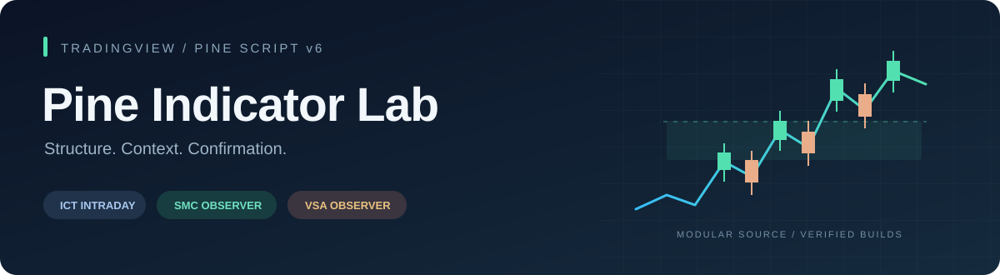
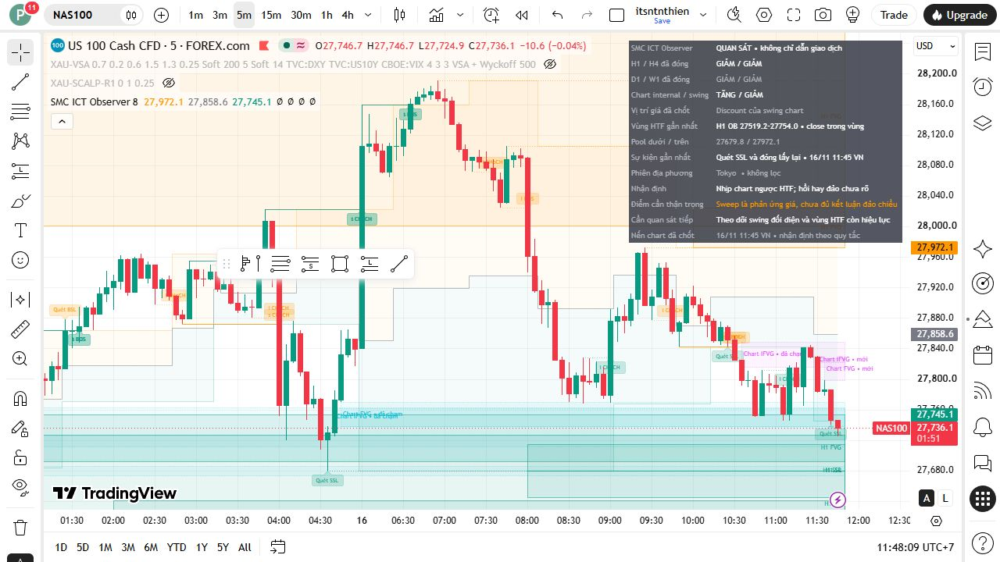
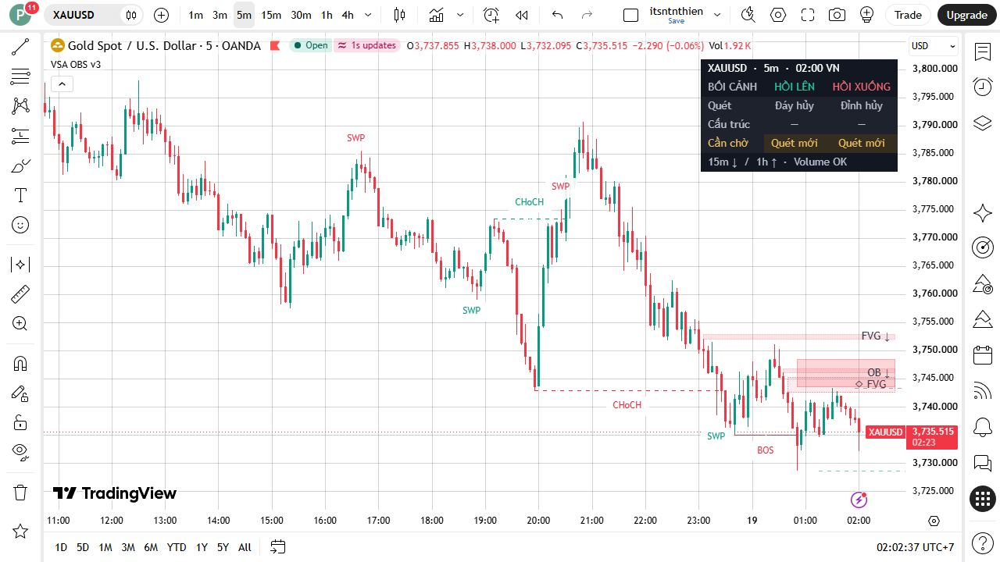
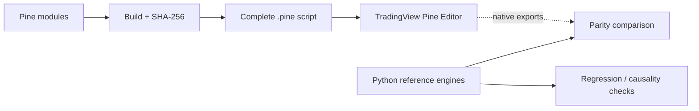

<p align="center">
  
</p>

<p align="center">
  <a href="https://github.com/itsntnthien/pine-indicator-lab/actions/workflows/verify.yml"></a>
  
  
  
</p>

<p align="center"><b>Bộ chỉ báo Pine Script cho TradingView.</b><br>
Cấu trúc thị trường · Thanh khoản · Vùng giá · Bối cảnh đa khung · VSA</p>

<p align="center">
  <a href="#chọn-chỉ-báo">Chọn chỉ báo</a> ·
  <a href="docs/INSTALLATION.md">Cài trên TradingView</a> ·
  <a href="docs/ARCHITECTURE.md">Kiến trúc</a> ·
  <a href="docs/VERIFICATION.md">Kiểm chứng</a> ·
  <a href="THIRD_PARTY.md">Nguồn & giấy phép</a>
</p>

---

**Pine Indicator Lab** tập hợp ba bộ chỉ báo được chọn lọc từ workspace phát
triển: **ICT Intraday**, **SMC / ICT Observer** và **VSA Observer v3**. Mỗi bộ có
mã Pine theo module, bản ghép sẵn để dùng trên TradingView, tài liệu quy tắc và
công cụ đối chứng. Python chỉ phục vụ build và kiểm thử logic chỉ báo.

Phạm vi nghiên cứu chính: **OANDA:XAUUSD** và **FOREXCOM:NAS100**. Với Intraday,
bối cảnh **H1/H4** kết hợp khung tìm setup **M5/M15**. Repo Private được chọn lọc
ngày **23/11/2026**.

> **Research / experimental.** Test phần mềm không chứng minh lợi nhuận. Bản
> VSA v3 hiện tại còn chờ kiểm tra native cho đúng hash cuối. Các trạng thái
> được trình bày theo từng chỉ báo trong [Verification](docs/VERIFICATION.md).

## Chọn chỉ báo

| Chỉ báo | Nội dung chính | Bản dùng ngay | Trạng thái |
|---|---|---|---|
| **ICT Intraday** | Vùng HTF, setup theo nến đóng, snapshot và mức giá tham chiếu | [Pine](dist/intraday/ICT_INTRADAY_EXPERIMENTAL.pine) · [Hướng dẫn](docs/INTRADAY_V1.md) | Experimental; native E2E còn thiếu |
| **SMC / ICT Observer** | Internal/swing, BOS/CHoCH, sweep, OB/FVG/IFVG và bảng bối cảnh | [Pine](dist/lux_custom/SMC_ICT_OBSERVER.pine) · [Hướng dẫn](docs/LUX_CUSTOM_OBSERVER.md) | Observation only; có bằng chứng native cùng hash |
| **VSA Observer v3** | Volume/biên nến, pool, sweep, cấu trúc và điều kiện hội tụ | [Pine](dist/vsa_observer/VSA_OBSERVER_V3.pine) · [Hướng dẫn](docs/VSA_OBSERVER_V3.md) | Draft; native retest pending |

**Dùng script trong `dist/`.** Các file `src/` là module chưa ghép và không dùng
riêng trong Pine Editor. VSA v2 được giữ làm fixture hồi quy và đường quay lại.

## Xem trước trên TradingView

### SMC / ICT Observer



*Ảnh kiểm chứng lịch sử ngày 16/11/2026: FOREXCOM:NAS100 M5. Bảng mô tả bối cảnh,
không phải chỉ dẫn mua/bán. [Nguồn và phạm vi ảnh](docs/assets/README.md).*

<details>
<summary><b>VSA Observer — ví dụ giao diện trên XAUUSD</b></summary>



Ảnh lịch sử của một bản UI v3 trước bản đóng gói hiện tại. Không dùng ảnh này để
chứng nhận giao diện hoặc compile native của hash cuối; xem
[trạng thái VSA](docs/VERIFICATION.md).

</details>

## Cài nhanh trên TradingView

1. Mở file **Pine** tương ứng ở bảng trên, chọn **Raw** và sao chép toàn bộ.
2. Trong TradingView, mở **Pine Editor**, tạo một **indicator mới**.
3. Dán toàn bộ script, lưu bằng tên riêng rồi chọn **Add to chart**.
4. Dùng nến tiêu chuẩn, chọn đúng symbol/feed và khung thời gian.
5. Đọc trạng thái warmup/dữ liệu trong dashboard trước khi diễn giải.

Không cần cài Python để dùng script đã ghép. Nếu đang thay bản cũ, giữ lại bản cũ
để quay lại; ưu tiên một instance trên chart để tránh hai bảng chồng lên nhau.

Hướng dẫn input, cập nhật, cảnh báo và xử lý lỗi:
[Installation](docs/INSTALLATION.md).

## Nguyên tắc thiết kế

- **Thời điểm xác nhận rõ ràng:** pivot nguồn và nến xác nhận là hai thời điểm
  khác nhau. Nhãn đặt về quá khứ không có nghĩa tín hiệu đã biết từ lúc đó.
- **Nến đóng và HTF:** kiểm tra dữ liệu khả dụng tại thời điểm quyết định,
  tránh đưa nến tương lai vào Python oracle hoặc Pine context.
- **Phân biệt các lớp:** cấu trúc, vùng, setup và hiển thị có trách nhiệm riêng.
- **Có thể truy vết:** mỗi build có SHA-256, đầu vào, phiên bản và attribution.
- **Kiểm chứng có giới hạn:** Python test, phân tích ngữ nghĩa, compile native,
  replay và hiệu quả giao dịch là các cổng khác nhau.



## Build và kiểm thử cho người phát triển

Python **3.13** là phiên bản kiểm chứng. Chạy từ root repo:

```powershell
git clone https://github.com/itsntnthien/pine-indicator-lab.git
cd pine-indicator-lab
python -m pip install -r requirements-test.txt
python -B tools/build_intraday.py
python -B tools/build_lux_custom.py
python -B tools/build_vsa_observer.py
python -B -m unittest discover -s tests -v
python -B tools/check_vsa_v3_mutations.py
python -B tools/verify_publication.py
```

Repo Private yêu cầu tài khoản có quyền truy cập. Build Python **ghép mã Pine**;
TradingView mới thực hiện compile và chạy chỉ báo native. Các bài test dùng
fixture tổng hợp và baseline được lưu, không cần dữ liệu tài khoản hay broker.

## Cấu trúc repo

```text
src/
  intraday/            config → context → zones → setup → ui
  lux_custom/          config → structure → regions → assessment → ui
  vsa_observer/        config → core → setup → ui → render
dist/                  Script Pine hoàn chỉnh + manifest build
tests/                 Hồi quy Python + harness Pine native
tools/                 Build, parser/parity và kiểm tra tính toàn vẹn
docs/                  Cài đặt, kiến trúc, đặc tả, kiểm chứng và ảnh
evidence/              Một số báo cáo lịch sử có hash
references/            Helper nội bộ tối thiểu mà oracle đang sử dụng
research/              Nguồn VSA gốc + baseline v2 bất biến
.github/               CI Windows/Linux và mẫu issue/PR
```

## Đọc tiếp

| Mục đích | Tài liệu |
|---|---|
| Cài, cập nhật, chọn input và xử lý lỗi | [Installation](docs/INSTALLATION.md) |
| Hiểu module và hợp đồng thời gian | [Architecture](docs/ARCHITECTURE.md) |
| Xem kết quả thực tế và các cổng còn thiếu | [Verification](docs/VERIFICATION.md) |
| Biết vì sao giữ hoặc bỏ từng nhóm tài sản | [Curation](docs/CURATION.md) |
| Đối chiếu nguồn/hash trước khi đóng gói | [Publication manifest](docs/PUBLICATION_MANIFEST.json) |
| Góp thay đổi / báo lỗi | [Contributing](CONTRIBUTING.md) · [Security](SECURITY.md) |
| Xem quyền sử dụng và ghi công | [License scope](LICENSE.md) · [Third-party notices](THIRD_PARTY.md) |

Các phần phái sinh LuxAlgo giữ **CC BY-NC-SA 4.0**. Không có giấy phép open-source
bao phủ toàn repo; mã gốc do người dùng cung cấp không được tự gán giấy phép mới.

<p align="center"><sub>Pine Script indicators for TradingView · Private research · Curated 23 November 2026</sub></p>
